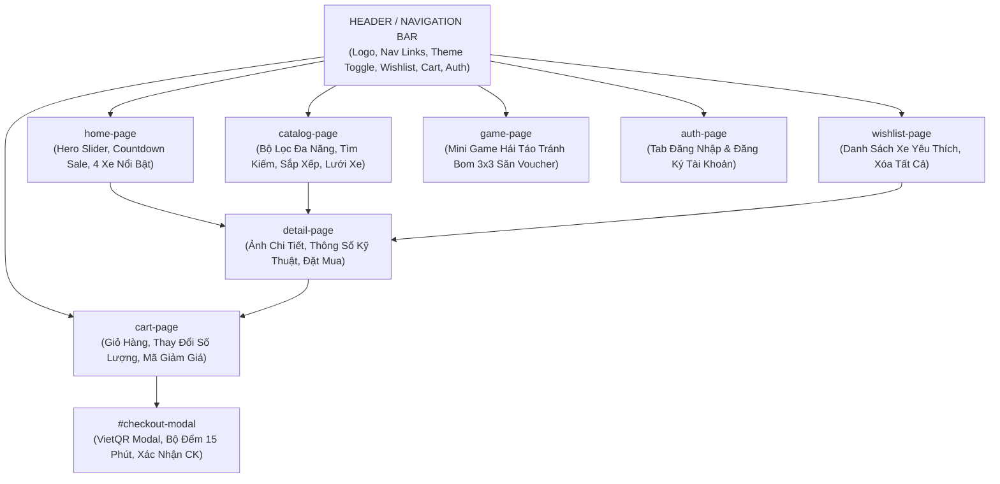

# TÀI LIỆU ĐẶC TẢ YÊU CẦU PHẦN MỀM & NGHIỆP VỤ HỆ THỐNG (SPECIFICATIONS)
## DỰ ÁN: MOTO STORE - SHOWROOM MÔ TÔ PHÂN KHỐI LỚN CAO CẤP
> **Môn học:** SOF309 – Kiểm thử nâng cao cùng AI  
> **Giảng viên hướng dẫn:** ThS. Trần Quang Bình (binhtq7 - Thầy Mười Giáo)  
> **Sinh viên thực hiện:** Tạ Minh Hoàng  
> **Mã số sinh viên (MSSV):** TS02696  
> **Mã Lớp:** SD21307  
> **Phiên bản:** 2.0 (Cập nhật hoàn thiện Tuần 2 & Lab 2 Kế thừa)  
> **Ngày cập nhật:** 18/11/2026  
> *Tài liệu này tổng hợp toàn bộ đặc tả kiến trúc Frontend SPA, Backend Controllers và Module kiểm thử thực hành kế thừa (Lab 2), làm cơ sở dữ liệu tri thức chuẩn (Knowledge Base) phục vụ AI RAG thiết kế Test Plan, Bộ Test Cases, Unit Testing (JUnit 5/JUnit 4) và UI Automation Testing (Selenium POM).*

---

## 📌 PHẦN I. THÔNG TIN TỔNG QUAN DỰ ÁN

| Hạng mục | Chi tiết đặc tả |
| :--- | :--- |
| **Tên dự án** | **MOTO STORE - Showroom Siêu Xe Mô Tô Phân Khối Lớn Cao Cấp** |
| **Mục tiêu hệ thống** | Cung cấp nền tảng số trưng bày xe mô tô phân khối lớn cao cấp (Superbike, Nakedbike, Adventure, Classic...), hỗ trợ khách hàng tìm kiếm, lọc xe theo tiêu chí, xem chi tiết thông số kỹ thuật, quản lý danh sách yêu thích, giỏ hàng, áp dụng voucher giảm giá và thanh toán chuyển khoản VietQR tự động. Tích hợp Mini Game gamification giữ chân khách hàng. |
| **Kiến trúc phát triển** | • **Frontend SPA (Single Page Application):** HTML5, CSS3, Tailwind CSS (JIT Engine), Font Awesome 6, JavaScript ES6+, LocalStorage API.<br>• **Backend Controllers (Java):** Xây dựng theo mô hình MVC tách biệt trong `com.poly.sof309.controllers`, quản lý nghiệp vụ và Exception chuyên biệt.<br>• **Môi trường Web chạy local:** `http://localhost:8080` (phục vụ từ `src/main/resources/static/`).<br>• **Khung kiểm thử kép (Dual-Engine):** JUnit 5 (Jupiter Engine) cho Controller Unit Test và JUnit 4 (Vintage Engine) cho Lab 2 Test Suite. |
| **Tích hợp bên thứ 3** | • **VietQR API:** Cổng tạo mã QR thanh toán động `https://img.vietqr.io` qua ngân hàng VietinBank (BIN 970415).<br>• **Unsplash CDN:** Nguồn dữ liệu hình ảnh siêu xe chất lượng cao. |

---

## 📌 PHẦN II. KIẾN TRÚC ĐIỀU HƯỚNG MÀN HÌNH (ROUTING ARCHITECTURE)

Hệ thống hoạt động theo mô hình Single Page Application (SPA), chuyển đổi hiển thị giữa các section thông qua hàm JavaScript `showPage(pageId)`. Tất cả các section mang class chung `.page-content`:



### Danh mục các trang và ID phần tử điều hướng:
1. **Trang Chủ (`#home-page`):** Hero Slider giới thiệu BMW S1000RR 2024, bộ đếm ngược Mega Sale hè (`#cd-days`, `#cd-hours`, `#cd-mins`, `#cd-secs`), danh mục 4 xe nổi bật (`#home-featured-grid`).
2. **Danh Mục Xe (`#catalog-page`):** Toàn bộ sản phẩm mô tô được render động tại `#catalog-grid`.
3. **Chi Tiết Xe (`#detail-page`):** Hiển thị chi tiết xe tại `#detail-content` gồm thư viện ảnh (`#detail-main-img`), giá niêm yết, thông số kỹ thuật (Dung tích xilanh, ODO, Năm sản xuất, Hộp số), địa chỉ showroom và cam kết kiểm định 170 hạng mục.
4. **Danh Sách Yêu Thích (`#wishlist-page`):** Hiển thị các xe người dùng đã "thả tim" tại `#wishlist-grid`, nút "Xóa tất cả" (`#clear-wishlist-btn`), giao diện rỗng (`#wishlist-empty-msg`).
5. **Giỏ Hàng (`#cart-page`):** Danh sách xe trong giỏ (`#cart-items-container`), hộp tóm tắt đơn hàng (`#summary-subtotal`, `#summary-discount`, `#summary-total`), ô nhập voucher (`#coupon-input`).
6. **Mini Game Hái Táo Tránh Bom (`#game-page`):** Bàn cờ 3x3 (`#game-grid`), bảng điểm (`#game-score`), trạng thái (`#game-status-text`), nút điều khiển (`#btn-start-game`).
7. **Xác Thực Người Dùng (`#auth-page`):** Chuyển tab Đăng nhập (`#tab-login`) và Đăng ký (`#tab-register`), Form đăng nhập (`#form-login`), Form đăng ký (`#form-register`).
8. **Modal Thanh Toán VietQR (`#checkout-modal`):** Ảnh QR động (`#vietqr-image`), thời gian giữ đơn (`#qr-timer`), số tiền (`#qr-amount`), nội dung chuyển khoản (`#qr-memo`).

---

## 📌 PHẦN III. QUY TẮC NGHIỆP VỤ & RÀNG BUỘC VALIDATION (BUSINESS RULES)

### 1. Phân hệ Xác thực Tài khoản (Authentication)
* **Đăng ký tài khoản (`#form-register`):**
  * `name`: Bắt buộc, độ dài từ 2 đến 50 ký tự, chỉ chứa chữ cái và khoảng trắng.
  * `email`: Bắt buộc, chuẩn định dạng RFC (`^[A-Za-z0-9+_.-]+@[A-Za-z0-9.-]+\\.[A-Za-z]{2,}$`), duy nhất trong hệ thống.
  * `phone`: Bắt buộc, 10 chữ số, bắt đầu bằng `03, 05, 07, 08, 09`.
  * `password`: Bắt buộc, độ dài biên $[8, 32]$ ký tự.
* **Đăng nhập (`#form-login`):**
  * Khớp với tài khoản trong cơ sở dữ liệu/LocalStorage hoặc tài khoản Quản trị viên mặc định (`admin@gmail.com` / `123456`).
  * Nếu đăng nhập đúng: Cập nhật Header thành `Hi, [Tên]`, lưu phiên làm việc.
  * Nếu sai: Hiển thị Toast cảnh báo lỗi, không đổi trạng thái.

### 2. Phân hệ Lọc & Tìm kiếm Sản phẩm (Catalog)
* **Tìm kiếm (`#filter-search`):** Không phân biệt hoa thường theo tên xe (`p.getName().toLowerCase().contains(keyword)`). Nếu rỗng trả về toàn bộ; nếu không tìm thấy trả về danh sách rỗng.
* **Lọc Dòng xe (`#filter-category`):** `Sportbike`, `Nakedbike`, `Adventure`, `Classic`.
* **Lọc Hãng xe (`#filter-brand`):** `BMW`, `Kawasaki`, `Ducati`, `Yamaha`, `Honda`, `Aprilia`, `KTM`.
* **Sắp xếp (`#filter-sort`):** `asc` (giá tăng dần), `desc` (giá giảm dần), `default` (mặc định).
* **Lọc kết hợp (Compound):** Thỏa mãn đồng thời cả 3 điều kiện (Tên AND Dòng xe AND Hãng xe).

### 3. Phân hệ Giỏ Hàng & Mã Giảm Giá (Cart & Coupon Engine)
* **Thêm sản phẩm (`addItem`):** Số lượng thêm phải là số nguyên dương $> 0$. Nếu mã sản phẩm không tồn tại, ném `ProductNotFoundException`.
* **Cập nhật số lượng (`updateQuantity`, `setQuantity`):** Nếu số lượng sau cập nhật $\le 0$, tự động xóa sản phẩm khỏi giỏ.
* **Mã giảm giá (`applyCoupon`):** Duy nhất mã **`MOTO10`** được chấp nhận (tự động trim và chuyển hoa). Giảm 10% trên tổng giá trị Subtotal. Nhập mã sai sẽ ném `InvalidCouponException`.

### 4. Phân hệ Thanh Toán VietQR Tự Động (VietQR Checkout)
* **Điều kiện:** Giỏ hàng phải có ít nhất 1 sản phẩm.
* **Cấu hình VietQR:** Ngân hàng VietinBank (BIN `970415`), STK `10288889999`, Memo `MOTO` + 4 chữ số ngẫu nhiên.
* **Đồng hồ đếm ngược:** Thời hạn giữ đơn 15 phút (900 giây). Hết giờ tự động hủy modal.

### 5. Phân hệ Mini Game "Hái Táo Tránh Bom" (Gamification)
* Ma trận $3 \times 3$, ngẫu nhiên xuất hiện Táo đỏ 🍎 (65%) và Bom đen 💣 (35%).
* Táo: $+10$ điểm. Bom: $-20$ điểm (điểm số không âm, tối thiểu $0$ điểm).
* Đạt $\ge 100$ điểm: Thưởng mã giảm giá `MOTO10`.

---

## 📌 PHẦN IV. ĐẶC TẢ CHI TIẾT CÁC LỚP CONTROLLER BACKEND (Y3 SPECIFICATION)

Để phục vụ kiểm thử đơn vị với **JUnit 5**, hệ thống xây dựng 3 Controller độc lập kèm bộ Exception chuẩn:

### 1. `com.poly.sof309.controllers.AuthController`
Quản lý xác thực và đăng ký người dùng:
```java
public class AuthController {
    // Xác thực tài khoản đăng nhập (hỗ trợ admin và tài khoản đã đăng ký)
    public boolean authenticate(String username, String password);
    
    // Đăng ký tài khoản mới với ràng buộc validation nghiêm ngặt
    public boolean register(String name, String email, String phone, String password) 
        throws IllegalArgumentException, DuplicateUserException;
        
    // Các hàm kiểm tra validation chuyên biệt
    public boolean validateEmail(String email);
    public boolean validatePhone(String phone);
    public boolean validatePassword(String password);
    public void resetData();
}
```
* **Ngoại lệ ném ra:**
  * `IllegalArgumentException`: Khi họ tên rỗng hoặc $< 2$ ký tự, hoặc email/phone/password sai định dạng.
  * `DuplicateUserException`: Khi email đăng ký đã tồn tại trong danh sách tài khoản.

### 2. `com.poly.sof309.controllers.CartController`
Quản lý giỏ hàng, cập nhật số lượng và tính tiền:
```java
public class CartController {
    // Thêm sản phẩm vào giỏ
    public void addItem(Long productId, int quantity) 
        throws InvalidQuantityException, ProductNotFoundException;
        
    // Tăng/giảm số lượng sản phẩm (delta: +1, -1)
    public void updateQuantity(Long productId, int delta);
    
    // Đặt trực tiếp số lượng sản phẩm
    public void setQuantity(Long productId, int quantity);
    
    // Tính tổng tiền tạm tính của giỏ hàng
    public double calculateSubtotal();
    
    // Áp dụng mã coupon giảm giá
    public double applyCoupon(String couponCode, double subtotal) 
        throws InvalidCouponException;
        
    // Tính tổng tiền cuối cùng sau chiết khấu
    public double calculateTotal(double subtotal, int discountPercent);
    
    public List<CartItem> getCartItems();
    public int getItemCount();
    public void clearCart();
}
```
* **Ngoại lệ ném ra:**
  * `InvalidQuantityException`: Khi thêm sản phẩm với số lượng $\le 0$.
  * `ProductNotFoundException`: Khi ID sản phẩm không có trong danh mục kho hàng.
  * `InvalidCouponException`: Khi mã giảm giá không hợp lệ (khác `MOTO10`).

### 3. `com.poly.sof309.controllers.ProductController`
Quản lý danh mục mô tô, tìm kiếm và phân loại:
```java
public class ProductController {
    public List<Motorcycle> getAllProducts();
    public Motorcycle getProductById(Long id);
    public List<Motorcycle> searchByName(String keyword);
    public List<Motorcycle> filterByCategory(String category);
    public List<Motorcycle> filterByBrand(String brand);
    public List<Motorcycle> filterCompound(String keyword, String category, String brand);
    public List<Motorcycle> sortProducts(List<Motorcycle> list, String sortOrder);
    public void addProduct(Motorcycle motorcycle);
}
```

---

## 📌 PHẦN V. ĐẶC TẢ MODULE KIỂM THỬ LAB 2 (KẾ THỪA NỀN TẢNG KIỂM THỬ)

Tích hợp toàn bộ kỹ thuật kiểm thử cốt lõi từ 4 bài Lab 2 môn Kiểm thử nâng cao:

### 1. Bài 1: Kiểm thử Đơn vị với MathFunc (`fpoly.junit.MathFunc`)
* **Hàm `factorial(int number)`:**
  * Tính giai thừa $N! = 1 \times 2 \times \dots \times N$.
  * **Ràng buộc nghiệp vụ:**
    * Nếu $N < 0$: Ném `IllegalArgumentException("Number must be greater than zero")`.
    * Nếu $N = 0$ hoặc $N = 1$: Kết quả là $1$.
    * Nếu $N > 1$: Tính tích lũy $N!$.
* **Hàm `plus(int num1, int num2)`:** Trả về tổng hai số nguyên $num1 + num2$.

### 2. Bài 2: Mô hình Test Suite & Runner (`fpoly.junit`)
* **Lớp `JUnitMessage`:** In thông điệp `message` ra console.
* **`SuiteTest1` & `SuiteTest2`:** Chứa các `@Test` kiểm tra thông điệp chuỗi.
* **`JunitTest` (`@RunWith(Suite.class)`):** Gom nhóm `SuiteTest1` và `SuiteTest2` thành một Suite kiểm thử hoàn chỉnh.
* **`SuiteRunner`:** Sử dụng `JUnitCore.runClasses(JunitTest.class)` để thực thi tập trung và báo cáo kết quả.

### 3. Bài 3: Chu trình Annotations trong JUnit (`fpoly.junit.JunitAnnotationsExample`)
Đặc tả thứ tự thực thi chuẩn của các Annotation:
1. `@BeforeClass`: Chạy duy nhất 1 lần trước toàn bộ các test method trong class (khởi tạo tài nguyên tĩnh).
2. `@Before`: Chạy trước mỗi test method (khởi tạo dữ liệu kiểm thử).
3. `@Test`: Thực thi ca kiểm thử cụ thể.
4. `@Ignore`: Đánh dấu ca kiểm thử tạm thời bị bỏ qua (không chạy).
5. `@After`: Chạy sau mỗi test method (dọn dẹp dữ liệu kiểm thử).
6. `@AfterClass`: Chạy duy nhất 1 lần sau khi tất cả test methods hoàn thành (giải phóng tài nguyên).

### 4. Bài 4: Hệ thống Điểm số & Xếp loại Học lực FPT Polytechnic (`fpoly.junit.bai4`)
* **Lớp `DiemHocSinh`:**
  * Hàm `tinhDiemTB(double toan, double van, double anh)`:
    * Thang điểm hợp lệ: $[0.0, 10.0]$ cho từng môn.
    * Ngoại lệ: Nếu bất kỳ điểm nào $< 0.0$ hoặc $> 10.0$, ném `IllegalArgumentException("Diem phai nam trong khoang tu 0.0 den 10.0")`.
    * Công thức tính: $\text{Điểm TB} = \frac{\text{Toán} \times 2 + \text{Văn} \times 2 + \text{Anh}}{5}$.
* **Lớp `XetHocLuc`:**
  * Hàm `xepLoai(double diemTB)`:
    * Thang điểm biên và phân vùng tương đương:
      * $\text{Điểm TB} \ge 9.0$: **"Xuất sắc"**
      * $8.0 \le \text{Điểm TB} < 9.0$: **"Giỏi"**
      * $6.5 \le \text{Điểm TB} < 8.0$: **"Khá"**
      * $5.0 \le \text{Điểm TB} < 6.5$: **"Trung bình"**
      * $0.0 \le \text{Điểm TB} < 5.0$: **"Yếu"**
    * Ngoại lệ: Điểm $< 0.0$ hoặc $> 10.0$ ném `IllegalArgumentException("Diem trung binh khong hop le")`.

---

## 📌 PHẦN VI. MA TRẬN PHÂN VÙNG TƯƠNG ĐƯƠNG & GIÁ TRỊ BIÊN (TEST DESIGN MATRIX)

| Module / Chức năng | Tham số / Trường dữ liệu | Vùng tương đương hợp lệ | Vùng tương đương không hợp lệ | Giá trị biên cần kiểm thử (BVA) |
| :--- | :--- | :--- | :--- | :--- |
| **Đăng Ký** | Họ và tên (`name`) | Chuỗi chữ cái 2 - 50 ký tự | Trống, $< 2$ ký tự, $> 50$ ký tự, chứa số | `""` (0 ký tự), `"A"` (1 ký tự), `"An"` (2 ký tự), 50 ký tự, 51 ký tự |
| | Email (`email`) | Đúng định dạng RFC | Trống, thiếu `@`, thiếu domain, đã tồn tại | `"test@"`, `"@fpt.edu.vn"`, `"admin@gmail.com"` |
| | Số điện thoại (`phone`) | 10 chữ số, đầu `03,05,07,08,09` | Trống, $< 10$ hoặc $> 10$ số, chứa chữ, đầu lạ | `090123456` (9 số), `0901234567` (10 số), `09012345678` (11 số) |
| | Mật khẩu (`password`) | $[8, 32]$ ký tự | Trống, $< 8$ ký tự, $> 32$ ký tự | 7 ký tự (Fail), 8 ký tự (Pass), 32 ký tự (Pass), 33 ký tự (Fail) |
| **Giỏ Hàng** | Số lượng (`quantity`) | Số nguyên $\ge 1$ | $\le 0$, số âm, NaN | `quantity = 0` (Xóa), `quantity = 1` (Hợp lệ), `quantity = -1` (Xóa) |
| | Mã Coupon | `"MOTO10"` (không phân biệt hoa/thường) | Khác `"MOTO10"` | `"MOTO10"`, `"moto10"`, `"MOTO"`, `"DISCOUNT50"` |
| **Tính Điểm** | Điểm từng môn | $[0.0, 10.0]$ | $< 0.0$ hoặc $> 10.0$ | `-0.1`, `0.0`, `10.0`, `10.1` |
| **Xếp Loại** | Điểm Trung Bình | $[0.0, 10.0]$ | $< 0.0$ hoặc $> 10.0$ | `4.9` (Yếu) vs `5.0` (TB), `6.4` (TB) vs `6.5` (Khá), `7.9` (Khá) vs `8.0` (Giỏi), `8.9` (Giỏi) vs `9.0` (Xuất sắc) |

---

## 📌 PHẦN VII. DANH SÁCH LOCATOR PHỤC VỤ SELENIUM POM (Y4 PREPARATION)

| Trang / Thành phần | Tên phần tử | By Locator | Loại phần tử |
| :--- | :--- | :--- | :--- |
| **AuthPage** | Tab Đăng Nhập | `By.id("tab-login")` | Button / Tab |
| | Tab Đăng Ký | `By.id("tab-register")` | Button / Tab |
| | Ô nhập Tài khoản Đăng nhập | `By.id("login-user")` | Input text |
| | Ô nhập Mật khẩu Đăng nhập | `By.id("login-pass")` | Input password |
| | Nút Submit Đăng Nhập | `By.xpath("//form[@id='form-login']//button[@type='submit']")` | Button |
| | Ô nhập Họ và Tên | `By.id("reg-name")` | Input text |
| | Ô nhập Email | `By.id("reg-email")` | Input email |
| | Ô nhập Số điện thoại | `By.id("reg-phone")` | Input tel |
| | Ô nhập Mật khẩu Đăng ký | `By.id("reg-pass")` | Input password |
| | Nút Submit Đăng Ký | `By.xpath("//form[@id='form-register']//button[@type='submit']")` | Button |
| **CatalogPage** | Ô tìm kiếm tên xe | `By.id("filter-search")` | Input text |
| | Bộ lọc Dòng xe | `By.id("filter-category")` | Select |
| | Bộ lọc Hãng xe | `By.id("filter-brand")` | Select |
| | Bộ lọc Sắp xếp giá | `By.id("filter-sort")` | Select |
| | Container lưới sản phẩm | `By.id("catalog-grid")` | Div Container |
| **CartPage** | Container giỏ hàng | `By.id("cart-items-container")` | Div Container |
| | Ô nhập mã giảm giá | `By.id("coupon-input")` | Input text |
| | Nút Áp dụng Coupon | `By.xpath("//button[contains(text(), 'Áp Dụng')]")` | Button |
| | Nút Thanh toán VietQR | `By.xpath("//button[contains(., 'Đặt Hàng & Thanh Toán QR')]")` | Button |
| **CheckoutModal** | Khung Modal VietQR | `By.id("checkout-modal")` | Div Modal |
| | Ảnh mã QR | `By.id("vietqr-image")` | Img |
| | Bộ đếm ngược 15 phút | `By.id("qr-timer")` | Span |
| | Nút Xác nhận Chuyển khoản | `By.xpath("//button[contains(., 'Đã Chuyển Khoản Thành Công')]")` | Button |
