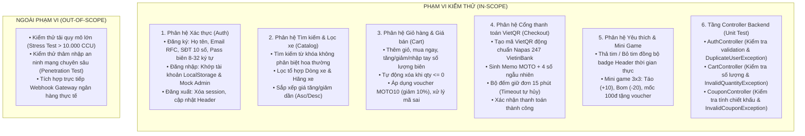

# KẾ HOẠCH KIỂM THỬ TỔNG THỂ (MASTER TEST PLAN)
## DỰ ÁN: MOTO STORE - SHOWROOM MÔ TÔ PHÂN KHỐI LỚN CAO CẤP
> **Môn học:** SOF309 – Kiểm thử nâng cao cùng AI  
> **Giảng viên hướng dẫn:** ThS. Trần Quang Bình (binhtq7 - Thầy Mười Giáo)  
> **QA Lead / Sinh viên thực hiện:** Tạ Minh Hoàng  
> **Mã số sinh viên (MSSV):** TS02696 | **Lớp:** SD21307  
> **Phiên bản:** 1.0 | **Ngày ban hành:** 11/11/2026  

---

## 📌 1. TỔNG QUAN & MỤC TIÊU KIỂM THỬ (TEST OBJECTIVES)

### 1.1. Mục tiêu chiến lược
* Đảm bảo tính đúng đắn toàn diện cho hệ thống Web **MOTO STORE**, từ tầng xử lý logic dữ liệu lõi (**Backend/Controller**) đến tầng trải nghiệm người dùng trên trình duyệt (**Frontend/UI**).
* Ứng dụng triệt để phương pháp kiểm thử kỹ thuật cao: **Phân vùng tương đương (Equivalence Partitioning - EP)** và **Phân tích giá trị biên (Boundary Value Analysis - BVA)** để phát hiện tối đa các lỗi tiềm ẩn tại các điểm chuyển tiếp dữ liệu.
* Xây dựng khung kiểm thử tự động hóa tiêu chuẩn công nghiệp:
  * **Unit Test (Y3):** Sử dụng **JUnit 5** với `@ParameterizedTest`, `@CsvSource`, `@Timeout` và `assertThrows()` để kiểm thử Controller logic với độ phủ 100% Pass.
  * **Automation UI Test (Y4):** Xây dựng theo mô hình **Page Object Model (POM)** trên nền **Selenium WebDriver 4** và **TestNG Framework** (hỗ trợ phân nhóm `groups = "smoke"`, Data-Driven `@DataProvider`, bắt sự kiện `ITestListener` tự động chụp ảnh lỗi `screenshots/`).
  * **Tự động hóa CI/CD (Y5):** Tích hợp kiểm thử tự động trên **GitHub Actions** ở chế độ Chrome Headless (`--headless=new`), xuất báo cáo Artifacts.
  * **Minh chứng AI (Y6):** Lưu vết toàn bộ quy trình RAG Prompting và tối ưu mã nguồn để đạt điểm tối đa (Hạng A: 8.0 - 10.0).

---

## 📌 2. PHẠM VI KIỂM THỬ (TEST SCOPE)

---

## 📌 3. CHIẾN LƯỢC & KỸ THUẬT KIỂM THỬ (TEST STRATEGY & TECHNIQUES)

### 3.1. Kỹ thuật thiết kế Test Case (Test Design Techniques)
1. **Phân vùng tương đương (Equivalence Partitioning - EP):**
   * Chia tập dữ liệu đầu vào thành các lớp tương đương hợp lệ (**Valid Partitions**) và không hợp lệ (**Invalid Partitions**).
   * Ví dụ với Email: Hợp lệ (`name@fpt.edu.vn`), Không hợp lệ thiếu `@` (`namefpt.edu.vn`), Không hợp lệ thiếu domain (`name@`).
2. **Phân tích giá trị biên (Boundary Value Analysis - BVA):**
   * Tập trung kiểm tra tại các giá trị biên của điều kiện kỹ thuật ($Min - 1, Min, Min + 1, Max - 1, Max, Max + 1$).
   * Ví dụ độ dài mật khẩu ($[8, 32]$): Test tại các độ dài 7 (Fail), 8 (Pass), 32 (Pass), 33 (Fail).
   * Ví dụ số lượng giỏ hàng: 0 (Xóa khỏi giỏ), 1 (Giữ giỏ), 99 (Biên trên).

### 3.2. Cấp độ kiểm thử (Testing Levels)
* **Cấp độ 1 - Unit Testing (Kiểm thử đơn vị Controller):**
  * Công cụ: **JUnit 5**.
  * Kế thừa môn cũ: `@ParameterizedTest` + `@CsvSource` quét đa bộ dữ liệu biên form; `assertThrows()` bắt ngoại lệ nghiệp vụ; `@Timeout(2s)` kiểm tra độ trễ.
* **Cấp độ 2 - System / UI Testing (Kiểm thử hệ thống giao diện):**
  * Công cụ: **Selenium WebDriver 4** kết hợp kiến trúc **Page Object Model (POM)**.
  * Tách biệt `pages/` (quản lý By Locator & Page Actions) và `tests/` (kịch bản kiểm thử Assert).
  * Đồng bộ hóa DOM hoàn toàn bằng **`WebDriverWait`** (Explicit Wait), cấm dùng `Thread.sleep()`.
* **Cấp độ 3 - Suite & Regression Testing (Điều phối kiểm thử hồi quy):**
  * Công cụ: **TestNG XML** điều phối thực thi.
  * Phân nhóm: Gắn tag `groups = {"smoke", "regression", "auth", "cart"}`.
  * Ràng buộc phụ thuộc logic: `dependsOnMethods` (Ví dụ: `testCheckout` phụ thuộc `testAddToCart`).
  * Tự động lưu bằng chứng: Cấu hình `ITestListener` tự động chụp ảnh màn hình lưu vào `screenshots/` khi một bước kiểm thử fail.
* **Cấp độ 4 - CI/CD Integration:**
  * Công cụ: **GitHub Actions** (`.github/workflows/test.yml`).
  * Thực thi trên Ubuntu Runner với cờ `--headless=new`, tự động đóng gói Artifacts kết quả test và ảnh chụp lỗi.

---

## 📌 4. MÔI TRƯỜNG KIỂM THỬ & CÔNG CỤ (TEST ENVIRONMENT)

| Thành phần | Đặc tả môi trường Local | Đặc tả môi trường CI/CD (GitHub Actions) |
| :--- | :--- | :--- |
| **Hệ điều hành** | Windows 11 (64-bit) | Ubuntu Latest (Linux Virtual Machine) |
| **Java Development Kit** | OpenJDK / Oracle JDK 17 (LTS) | `actions/setup-java@v4` (Java 17 Temurin) |
| **Build & Dependencies** | Apache Maven 3.9+ | `mvn clean test` qua Maven Wrapper |
| **Trình duyệt kiểm thử** | Google Chrome (Phiên bản mới nhất) | Google Chrome Headless (`--headless=new`, `--no-sandbox`) |
| **WebDriver** | Selenium Manager / ChromeDriver tự động | Selenium 4.20.0 native driver |
| **IDE & Soạn thảo** | Visual Studio Code / IntelliJ IDEA Ultimate | GitHub Actions Workflow Environment |
| **Môi trường Web chạy test** | `http://localhost:8080` (Spring Boot / Live Server) | `src/main/resources/static/index.html` |

---

## 📌 5. QUY TRÌNH QUẢN LÝ LỖI & TIÊU CHÍ ĐÁNH GIÁ (DEFECT MANAGEMENT & CRITERIA)

### 5.1. Phân loại mức độ nghiêm trọng của lỗi (Defect Severity)
1. **Critical (Nghiêm trọng cấp 1):** Không thể đăng nhập, không thể thêm sản phẩm vào giỏ hàng, ứng dụng bị crash hoặc treo DOM.
2. **Major (Nghiêm trọng cấp 2):** Tính toán sai tiền (Subtotal/Total), áp dụng voucher `MOTO10` sai tỉ lệ %, không hiển thị mã VietQR.
3. **Medium (Trung bình):** Bộ lọc không trả về đúng sản phẩm, validation hiển thị sai thông điệp lỗi, nút sắp xếp giá không đảo thứ tự.
4. **Minor (Nhẹ):** Lỗi chính tả, lỗi canh lề giao diện Dark/Light mode, hiệu ứng toast biến mất quá nhanh.

### 5.2. Tiêu chí nghiệm thu (Suspension & Exit Criteria)
* **Tiêu chí dừng (Suspension Criteria):** Mã nguồn bị lỗi biên dịch (`BUILD FAILURE`), không khởi động được Web ở `localhost:8080`, hoặc chromedriver không tương thích phiên bản Chrome.
* **Tiêu chí hoàn thành (Exit Criteria - Đạt Điểm A):**
  * 100% các Test Case trong `docs/TEST_CASES.md` được triển khai thành mã kiểm thử.
  * Toàn bộ kịch bản kiểm thử Controller và UI chạy đạt kết quả **100% PASS** (Không có Failure / Error).
  * Pipeline trên tab **GitHub Actions** hiển thị tích **Xanh lá cây**.
  * Đầy đủ 6 file nhật ký minh chứng tương tác AI trong thư mục `docs/ai-logs/`.

---

## 📌 6. LỊCH TRÌNH THỰC HIỆN & PHÂN CÔNG (TIMELINE & RESPONSIBILITY)

| Giai đoạn | Tuần thực hiện | Nội dung công việc QA Lead | Sản phẩm nghiệm thu |
| :---: | :---: | :--- | :--- |
| **Phase 1** | **Tuần 1** | Hoàn thành đặc tả `SPECIFICATIONS.md`, lập `TEST_PLAN.md` và bảng `TEST_CASES.md` bằng AI RAG. | Đầy đủ 3 file tài liệu chuẩn |
| **Phase 2** | **Tuần 2** | Lập trình Unit Test cho Controller (`AuthControllerTest`, `CartControllerTest`) với `@ParameterizedTest` và `assertThrows()`. | Lệnh `mvn test` đạt 100% Pass |
| **Phase 3** | **Tuần 3** | Xây dựng khung Selenium POM (`LoginPage`, `RegisterPage`, `CatalogPage`, `CartPage`) với `WebDriverWait`. | Kịch bản Selenium mở Chrome mượt mà |
| **Phase 4** | **Tuần 4** | Nâng cấp TestNG XML, phân nhóm `groups`, áp dụng `@DataProvider` và cấu hình chụp ảnh lỗi vào `screenshots/`. | File `testng.xml` & bộ test suite |
| **Phase 5** | **Tuần 5** | Cấu hình GitHub Actions CI/CD (`test.yml`), chạy Chrome Headless trên Ubuntu và tải Artifacts. | Tab Actions GitHub báo Xanh |
| **Phase 6** | **Tuần 6** | AI Code Review, rà soát đủ 6 file `docs/ai-logs/`, soạn slide và sẵn sàng bảo vệ Assignment. | Bộ hồ sơ Điểm A hoàn chỉnh |
