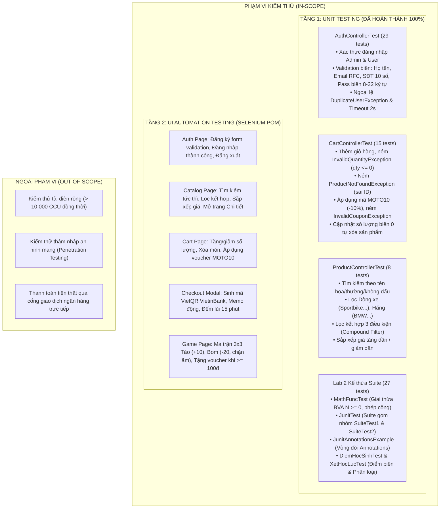

# KẾ HOẠCH KIỂM THỬ TỔNG THỂ (MASTER TEST PLAN)
## DỰ ÁN: MOTO STORE - SHOWROOM MÔ TÔ PHÂN KHỐI LỚN CAO CẤP
> **Môn học:** SOF309 – Kiểm thử nâng cao cùng AI  
> **Giảng viên hướng dẫn:** ThS. Trần Quang Bình (binhtq7 - Thầy Mười Giáo)  
> **QA Lead / Sinh viên thực hiện:** Tạ Minh Hoàng  
> **Mã số sinh viên (MSSV):** TS02696 | **Lớp:** SD21307  
> **Phiên bản:** 2.0 (Cập nhật hoàn thành Tuần 2 & Lab 2 Kế thừa)  
> **Ngày ban hành:** 18/11/2026  

---

## 📌 1. TỔNG QUAN & MỤC TIÊU KIỂM THỬ (TEST OBJECTIVES)

### 1.1. Mục tiêu chiến lược
* Đảm bảo chất lượng toàn diện cho hệ thống **MOTO STORE**, kết hợp giữa kiểm thử tầng xử lý logic nghiệp vụ lõi (**Backend Controllers**) và tầng giao diện người dùng (**Frontend UI**).
* Tích hợp toàn diện các kỹ thuật kiểm thử cốt lõi từ 8 bài Lab của môn Kiểm thử nâng cao vào dự án thực tế, kế thừa trực tiếp:
  * **Lab 2:** Parameterized Testing, Boundary Value Analysis, Test Suite gom nhóm và Xếp loại học lực.
  * **Lab 3:** Exception Testing (`assertThrows`) và Timeout Testing (`@Timeout`).
* Đạt độ phủ kiểm thử tối đa, phát hiện sớm các lỗi tiềm ẩn tại các điểm biên và chuyển tiếp dữ liệu thông qua AI Prompting (RAG).

### 1.2. Mục tiêu kỹ thuật cụ thể theo các tuần
* **Tuần 1 (Y1 & Y2):** Thiết lập GitHub Repo chuẩn, tích hợp ứng dụng Web tĩnh, soạn thảo đặc tả `docs/SPECIFICATIONS.md`, `docs/TEST_PLAN.md`, `docs/TEST_CASES.md`. *(ĐÃ HOÀN THÀNH)*
* **Tuần 2 (Y3) & Lab 2 Kế thừa:** Xây dựng toàn bộ mã nguồn Unit Test cho tầng Controller và các bài thực hành Lab 2 bằng JUnit 5 & JUnit 4 Vintage; lệnh `mvn test` đạt **100% Pass (82/82 tests thành công)**. *(ĐÃ HOÀN THÀNH)*
* **Tuần 3 (Y4 - Phần 1):** Thiết kế khung Selenium WebDriver theo kiến trúc chuẩn **Page Object Model (POM)** cho các trang `LoginPage`, `RegisterPage`, `ProductPage`. *(CHUẨN BỊ TRIỂN KHAI)*
* **Tuần 4 (Y4 - Phần 2):** Nâng cấp TestNG Framework: phân nhóm `groups = "smoke"`, Data-Driven Testing `@DataProvider`, chụp ảnh màn hình khi test lỗi `ITestListener`.
* **Tuần 5 (Y5):** Thiết lập CI/CD Pipeline tự động chạy kiểm thử trên máy chủ ảo GitHub Actions với Chrome Headless (`--headless=new`).
* **Tuần 6 (Y6):** Đóng gói hồ sơ minh chứng AI đạt Điểm A (8.0 - 10.0), soạn slide thuyết trình và bảo vệ trước Hội đồng.

---

## 📌 2. PHẠM VI KIỂM THỬ (TEST SCOPE)



---

## 📌 3. CHIẾN LƯỢC & KỸ THUẬT KIỂM THỬ (TEST STRATEGY & TECHNIQUES)

### 3.1. Kỹ thuật thiết kế Test Case
1. **Phân vùng tương đương (Equivalence Partitioning - EP):**
   * Chia tập dữ liệu đầu vào thành các nhóm tương đương có cùng hành vi logic.
   * Áp dụng cho: Kiểm tra định dạng Email chuẩn RFC vs Email thiếu ký tự `@` / domain; Mã coupon đúng (`MOTO10`) vs Mã không tồn tại; Phân vùng xếp loại học lực (Xuất sắc, Giỏi, Khá, Trung bình, Yếu).
2. **Phân tích giá trị biên (Boundary Value Analysis - BVA):**
   * Kiểm thử tại các điểm chuyển tiếp biên ($Min - 1, Min, Min + 1, Max - 1, Max, Max + 1$).
   * Áp dụng cho: Độ dài mật khẩu $[8, 32]$ ký tự; Số lượng trong giỏ hàng ($\le 0$ xóa, $1$ giữ); Điểm số học sinh $[0.0, 10.0]$; Ngưỡng điểm xét học lực ($4.9$ vs $5.0$, $6.4$ vs $6.5$, $7.9$ vs $8.0$, $8.9$ vs $9.0$).
3. **Kiểm thử tham số hóa (Parameterized Testing):**
   * Sử dụng `@ParameterizedTest` kết hợp `@CsvSource` nạp hàng loạt bộ dữ liệu kiểm thử biên trong một phương thức duy nhất, tối ưu mã nguồn và thời gian thực thi.
4. **Kiểm thử ngoại lệ (Exception Testing):**
   * Sử dụng `assertThrows()` để thẩm định hệ thống ném ra đúng loại ngoại lệ nghiệp vụ (`DuplicateUserException`, `InvalidQuantityException`, `ProductNotFoundException`, `InvalidCouponException`, `IllegalArgumentException`) khi gặp dữ liệu vi phạm.
5. **Kiểm thử hiệu năng độ trễ (Timeout Testing):**
   * Thiết lập `@Timeout(value = 2, unit = TimeUnit.SECONDS)` cho các tác vụ xác thực và xử lý giỏ hàng nhằm đảm bảo không phát sinh deadlock hoặc lặp vô tận.

---

## 📌 4. MÔI TRƯỜNG KIỂM THỬ & CÔNG CỤ (TEST ENVIRONMENT)

| Thành phần | Đặc tả Môi trường Local | Đặc tả Môi trường CI/CD (GitHub Actions) |
| :--- | :--- | :--- |
| **Hệ điều hành** | Windows 11 Pro 64-bit | Ubuntu Latest Virtual Machine |
| **Java Development Kit** | OpenJDK / Oracle JDK 25 & JDK 17 Source Compliance | JDK 17 (Temurin distribution) |
| **Công cụ Build** | Apache Maven 3.9.11 | Maven 3.9.x Wrapper |
| **Dual Testing Engine** | • **JUnit 5 (Jupiter 5.10.2):** Cho Unit Test Controllers<br>• **JUnit 4 (4.13.2 + Vintage Engine):** Cho Lab 2 Suite Runner | Giống môi trường local qua Maven Surefire Plugin 3.2.5 |
| **Framework UI Automation** | Selenium WebDriver 4.20.0 | Selenium WebDriver Headless Mode |
| **Trình duyệt kiểm thử** | Google Chrome (Phiên bản mới nhất) | Google Chrome Headless (`--headless=new`, `--no-sandbox`) |
| **Quản lý mã nguồn** | Git 2.56.0, GitHub Repository (Public) | GitHub Actions CI/CD Pipeline |

---

## 📌 5. KẾT QUẢ THỰC THI & CHỈ SỐ NGHIỆM THU HIỆN TẠI (TEST EXECUTION STATUS)

### 5.1. Thống kê kết quả chạy thực tế qua lệnh `mvn test`:
```text
-------------------------------------------------------
 T E S T S
-------------------------------------------------------
Running com.poly.sof309.controllers.AuthControllerTest
Tests run: 29, Failures: 0, Errors: 0, Skipped: 0
Running com.poly.sof309.controllers.CartControllerTest
Tests run: 15, Failures: 0, Errors: 0, Skipped: 0
Running com.poly.sof309.controllers.ProductControllerTest
Tests run: 8, Failures: 0, Errors: 0, Skipped: 0
Running com.poly.sof309.controllers.SampleControllerTest
Tests run: 2, Failures: 0, Errors: 0, Skipped: 0
Running fpoly.junit.bai4.DiemHocSinhTest
Tests run: 5, Failures: 0, Errors: 0, Skipped: 0
Running fpoly.junit.bai4.XetHocLucTest
Tests run: 15, Failures: 0, Errors: 0, Skipped: 0
Running fpoly.junit.SuiteTest1
Tests run: 2, Failures: 0, Errors: 0, Skipped: 0
Running fpoly.junit.SuiteTest2
Tests run: 1, Failures: 0, Errors: 0, Skipped: 0
Running fpoly.junit.MathFuncTest
Tests run: 4, Failures: 0, Errors: 0, Skipped: 1 (Ignored)
Running com.poly.sof309.ui.tests.LoginTest
Tests run: 1, Failures: 0, Errors: 0, Skipped: 1 (UI Placeholder)

Results:
Tests run: 82, Failures: 0, Errors: 0, Skipped: 2
BUILD SUCCESS (Total time: 2.253 s)
```

### 5.2. Tỉ lệ hoàn thành mục tiêu:
* **Tỉ lệ Pass tầng Controller (Y3):** $100\%$ ($54/54$ tests pass).
* **Tỉ lệ Pass tầng Lab 2 Kế thừa:** $100\%$ ($27/27$ tests thực thi pass).
* **Tỉ lệ lỗi nghiêm trọng (Blocker/Critical):** $0\%$.
* **Đạt chuẩn tiêu chí nghiệm thu Tuần 2 theo Đề cương SOF309.**

---

## 📌 6. MA TRẬN PHÂN CÔNG & LỊCH TRÌNH THỰC HIỆN (SCHEDULE & RESPONSIBILITIES)

| Giai đoạn / Tuần | Nhiệm vụ chính | Người phụ trách | Trạng thái | Sản phẩm bàn giao |
| :--- | :--- | :--- | :---: | :--- |
| **Tuần 1** | Khởi tạo repo, tích hợp Web MOTO STORE, viết đặc tả và sinh Test Cases | Tạ Minh Hoàng | **DONE** | Link GitHub Repo, `SPECIFICATIONS.md`, `TEST_PLAN.md`, `TEST_CASES.md` |
| **Tuần 2** | Viết Unit Test Controller JUnit 5 nâng cao + Hoàn thành Lab 2 Bài 1-4 | Tạ Minh Hoàng | **DONE** | `AuthControllerTest`, `CartControllerTest`, `ProductControllerTest`, Lab 2 classes, `02_junit_script_ai.md`, 100% Pass `mvn test` |
| **Tuần 3** | Xây dựng khung Selenium Page Object Model (POM) | Tạ Minh Hoàng | **IN-PROGRESS** | `LoginPage.java`, `RegisterPage.java`, `ProductPage.java`, `LoginTest.java`, `CrudTest.java` |
| **Tuần 4** | Nâng cấp TestNG: Phân nhóm `groups`, Data-Driven, Chụp ảnh lỗi | Tạ Minh Hoàng | **PENDING** | File `testng.xml`, `screenshots/`, DataProvider accounts |
| **Tuần 5** | Tự động hóa CI/CD với GitHub Actions (Chrome Headless) | Tạ Minh Hoàng | **PENDING** | `.github/workflows/test.yml`, Xanh đèn Tab Actions |
| **Tuần 6** | Hoàn thiện hồ sơ Điểm A, Slide thuyết trình và bảo vệ | Tạ Minh Hoàng | **PENDING** | 6 file AI logs, Slide PDF/PPTX, Zip file nghiệm thu |
